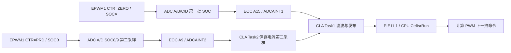

# 当前代码逻辑与设计对应关系

## 1. 设计输入与判断

目标器件 F28374S，T 型三电平三相 PCS，每相额定 5 kW。目标 INV/PV/BUS 为 20 kHz，GPIO 对应关系按用户给定接受。现有结构有配置表、通用驱动、组件和应用的雏形，但模块间依赖尚未形成单向边界。

| 层 | 当前内容 | 与目标的差距 |
|---|---|---|
| Broad | GPIO、PWM、ADC、CLA、SCI、CAN、eCAP、X-BAR、保护、通信、存储配置 | 同一文件混合硬件资源与应用协议点表；ADC 表布局与驱动接口不一致 |
| Drivers | 寄存器初始化、PWM/INV、ADC/CLA、通信、捕获、外部中断 | 同步寄存器使用了不适用于本芯片的布局；SCI 依赖 Platform RingBuff；部分接口把安全状态隐藏在调用顺序里 |
| Platform/Common | 环形缓冲、CRC、FRAM/参数保存、ATS | EepromParam 反向依赖 User_App Modbus 点表；采样组件、保护组件仍放在 User_App |
| User_App | CLA、控制 ISR、采样标定、保护、调度、协议、所有状态机、看门狗 | 删除整个目录会连底层运行所需的 CLA、向量、节拍、喂狗一并删除，须先迁移 |

## 2. 实际启动顺序

`main → PeripheralsInit → ApplicationInit(空) → PlatformInit → TaskCreate → StartSystem → Task_Run 循环`。

PeripheralsInit 内依次完成 InitSysCtrl、PIE、定时器配置、GPIO、X-BAR、PWM、TZ、INV、ADC、CLA、eCAP、SCI、CAN、I2C/FRAM、SPI、XINT，再启动 Timer1/2 并执行 EINT。**Hw_PwmInit 已经放开 TBCLKSYNC，因此启动采样并不真正等到 StartSystem。** PlatformInit 此时还在初始化采样、标定、控制状态、保护、协议、参数和继电器。

StartSystem 清除所有 TZ 标志、将 INV 置中点钳位、再次放开 PWM 时基、关闭发波请求、配置并启动看门狗。清 TZ 不能作为修复 ADC/CLA 中断的办法：TZ 输出动作与时基/SOC 的继续运行是不同路径。

实际存在两个“开始”：外设初始化中已开始运行时基，应用初始化后才宣称正式开始。这是数据和状态竞态来源。

## 3. PWM 资源和开关状态

| 功能 | 模块 | A 输出 | B 输出 | 当前计数/周期 |
|---|---|---|---|---|
| R 正支路 | EPWM1 | S1 | S3 | up-down，2500 |
| R 负支路 | EPWM4 | S4 | S2 | up-down，2500 |
| S 正/负支路 | EPWM2 / EPWM10 | S1 / S4 | S3 / S2 | up-down，2500 |
| T 正/负支路 | EPWM3 / EPWM11 | S1 / S4 | S3 / S2 | up-down，2500 |
| PV1 / PV2 / PV3 / PV4 | EPWM7 / 9 / 5 / 6 | Boost 开关 | 未作为功率输出使用 | up，5000 |
| BUS | EPWM8 | 正半母线 MOS | 负半母线 MOS | up-down，2500 |

按 SYSCLK=200 MHz、EPWMCLK=100 MHz、TBCLK=100 MHz：INV/BUS 为 20,000 Hz；PV up 模式为 100 MHz/(5000+1)=19,996.0008 Hz。严格统一 20 kHz 时，up 模式 TBPRD 应为 4999，并重新算交错相位。

INV 的 AQ 在上数 CMPA 置位、下数 CMPA 清零，理想占空比 `d=(TBPRD-CMPA)/TBPRD`；死区以 A 为源产生互补 B。DBRED/FED=80，在半周期计数关闭的条件下为 800 ns。这个数值的寄存器换算成立，但是否足够需结合驱动与 MOS 实测。

用户要求的逻辑真值表（1=门极导通命令，互补间有死区）：

| 状态 | S1 | S3 | S4 | S2 |
|---|---|---|---|---|
| 正半周斩波 | PWM+ | complement(PWM+) | 0 | 1 |
| 负半周斩波 | 0 | 1 | PWM− | complement(PWM−) |
| 中点钳位 | 0 | 1 | 0 | 1 |
| 故障全关 | 0 | 0 | 0 | 0 |

`Hw_InvStopAll` 实现意图是中点钳位；`Hw_InvTripAll` 才通过 OST 请求全关。不能将两个状态混用。BUS 的互补 B 也不能靠“强制 AQ A 低”理解为双管全关。

Hw_InvSetDuty 缓存上次斩波模块、占空比和两拍换相标记。换极性时，若缓存占空比大于 EPS，先钳位一拍、下一拍释放；否则直接释放新支路。缓存代表已写命令，不代表活动比较寄存器/门极状态。当前全局装载被强制关闭、同步路径错误，故这套时序不能证明换相安全。

此外 GPIO88（表注释为高有效驱动使能）初始为低，未找到应用置高路径。即使 DSP 引脚有 PWM，也不能据此推断实际栅极有驱动。

## 4. 采样—CLA—ISR 链路

设计意图：

### 4.1 表作者期望的采样分配

| SOC | ADCA | ADCB | ADCC | ADCD |
|---|---|---|---|---|
| 0 SOCA | A2 T 电流 | B2 T 直流分量 | — | D2 S 电流 |
| 1 SOCA | — | B0 R 直流分量 | — | D14 R 电流 |
| 2 SOCA | — | B1 S 直流分量 | C2 PV2 电流 | D1 GFCI |
| 3 SOCA | A3 T 电网电压 | B3 MUX2 | C3 S 逆变电压 | D3 MUX1 |
| 4 SOCA | A4 PV1 电流 | — | C4 R 逆变电压 | D0 PV3 电流 |
| 5 SOCA | A5 R 电网电压 | — | — | D4 BUS 平衡电流 |
| 6 SOCA | A0 T 逆变电压 | — | — | D15 PV4 电流 |
| 7 SOCA | A1 S 电网电压 | — | — | — |
| 8 SOCB | A2 T 电流第二采样 | — | — | D2 S 电流第二采样 |
| 9 SOCB | A0 完成锚点 | — | — | D14 R 电流第二采样 |
| 15 SOCA | A0 完成锚点 | — | — | — |

各 ADC 单独串行转换，四 ADC 可并行；“三个电流同一个 PWM 事件触发”不等于三个采样孔径相同，R 相在 D 的第二个 SOC。应把这种延迟纳入采样相位预算。

### 4.2 当前实际配置

表按 `SOC×4+ADC编号` 排列，但驱动按 `起点ADC编号+SOC` 连续取 16 项。见 evidence CSV：54/64 项不同。ADCA SOC15 实际为 `{SOCA,120,通道3}`，SOC9 为 `{SOCA,60,通道1}`；**不是 SOC15 完全没配置，而是配错内容和批次。** 全部 ADC 实际均无 SOCB 项。

因此 ADCINT1/2 可能仍产生，不能简单说硬件一定不启动 CLA；但任务时序、数据内容不符合设计。再叠加 CLA 消息 RAM 方向反了，CPU 看到的序号/结果无法按正常写路径更新，容易表现为 CLA 停摆或后级故障。

修复 stride 后还有独立问题：默认 round-robin 指针在 SOCB 完成后为 9，下一次 SOCA 可先执行 15 再执行 0…7；不能将最高 SOC 编号直接当作本批最后完成的屏障。需要显式优先级、排程和跨 ADC 最坏完成时间证明。

### 4.3 CLA 与采样处理

Task1：三相电流与 Task2 历史值取均值；逆变/电网电压、PV 电流、直流分量、BUS 电流、GFCI 做一阶滤波；按 CPU 提供的 MUX 地址归档 PV 电压和半母线；最后序号自增。Task2 意图搬移第二采样，但实际仍读 ADCRESULT0/1 而非 SOC8/9。

`y += alpha*(x-y)` 中 AC alpha=0.06，20 kHz 下截止约 197 Hz，50 Hz 相移约 −14°，不是注释宣称的约 2 kHz。MUX 六个地址轮询，每个地址约 3.33 kHz，半母线量不是每拍新采样；动态控制使用时需要时间戳/有效位。

CLA 程序在 Flash 装载、复制至 LS 程序 RAM；MAP 能看到 Task1/2 和 Cla_Lpf 在 CLA 程序段，滤波状态与 scratchpad 位于 LS 数据区。主要确定错误是两个消息段颠倒，不是“CLA 文件没参加编译”或“Cla_Lpf 没被链接”。

### 4.4 CPU 控制和后台

Task1 完成进入 PIE11.1。CtrlIsrRun 完成标定、保护调用、序号检查、状态机分频、PLL/角度与正弦调制、INV duty 下发、MUX 切换及采样换算；Timer2 用于测 ISR 执行时间。AdcSample 再提供瞬时、RMS、平均和对外镜像。

Timer1 为 100 µs 节拍，驱动合作式后台调度并监控控制计数。主要后台任务：SCI 扫描 100 µs、Modbus 200 µs、SoftOsc 400 µs、采样发布/数据镜像/参数保存/ATS 动作 1 ms、ATS 协议维护 100 ms。后台任务按调用执行，不具有抢占式实时调度保障。

## 5. 通信与存储

| 通道 | 当前配置 | 当前上层路径 |
|---|---|---|
| SCIA | 19200，8N1，RX FIFO 阈值8 | ARM Modbus 从机，地址1 |
| SCIC | 115200，8N1，RX FIFO 阈值8 | 只听地址3 + ATS 请求/响应监听；TVS/ATS 注释混用需冻结实际协议 |
| SCID | 38400，8N1，RX FIFO 阈值8 | PC Modbus 从机，地址2 |
| CANA | 500 kbit/s，标准帧 | 配置报文对象；标准 ID 编码错误 |
| CANB | 1 Mbit/s，扩展帧 | SoftOsc 遥测；需监测发送邮箱忙/总线错误 |
| SPIA | 软件片选、多字节同步传输接口 | 已初始化，未找到完整 ARM 应用收发协议调用；8位接收移位错误 |
| GPIO I2C | 声称400 kHz，软件延时 | FM24C128D，参数头+数据+CRC，异步分片写 |

SCI ISR 搬移至环形缓冲，后台以软件收到的字节计数判断帧尾。CRC/地址/功能码和点表在 Modbus 层处理；从机实现03读、06写单寄存器、10写多个寄存器，未实现04读输入寄存器；ATS监听器单独识别03/04。CRC 表重放的 `123456789` 结果为 0x4B37，未发现表错误，但这不能补救物理接收截断。点表静态检查：ARM399项、PC111项、TVS1项，未发现地址逆序或寄存器宽度重叠；32位字序的预处理选择仍有错误（F34）。

DataExchangeTx 发布状态；DataExchangeRx 尚为空，ARM 写入命令镜像不等于驱动系统执行。参数保存扫描可保存点表，合并脏区后写 FRAM，当前仅单份有效数据，缺少跨掉电事务保障。

## 6. 保护和状态机

硬件目标：GPIO 比较器 → INPUT X-BAR → ePWM X-BAR TRIP → DCA/DCB EVT2 → CBC；XINT 另外计数 INV 过流/短路，软件累计后锁存 OST。当前 X-BAR MUX 编号错，且低有效信号先 OR 再低有效判断的逻辑错误，不能依赖这条保护链。

软件有两套保护表示：ProtectTask 的硬件事件/锁存及 ProtectInput/ProtectFault 的阈值/协议字。后者的大量配置项尚无实际输入判据，不能把配置表有名字理解为保护已实现。BUS 过流/母线过压未接入 PWM TZ 表。

System/Inv 状态机包括上电、标定、自检、软启动、合闸、运行、故障重试。INV 目前主要为 R 相 RMS 幅值误差调整公共调制比，加三相正弦输出。PV 有电压环/MPPT 状态骨架，但输出仍受初始化 force 压制；BUS 只有压差监视，PI 和实际 PWM 下发留空。

## 7. 与用户控制目标的结论

| 目标 | 当前判断 |
|---|---|
| 指定 INV/PV/BUS 引脚与模块 | 表达关系基本吻合；GPIO88使能生命周期缺失 |
| 正/负半周 T 型单极性逻辑 | 稳态意图匹配；启动释放、同步装载、过零换相、故障状态未验证且有缺陷 |
| INV/PV/BUS统一20kHz | INV/BUS数字计算符合；PV周期差1，交错同步未实现 |
| PWM→ADC→CLA→ISR | 资源选型可行；表stride、RAM方向、屏障和第二采样读取阻断实际目标 |
| 离网瞬时电压环/双环+前馈/重复控制 | 尚未实现；现有RMS幅值调节不能等同于该闭环 |
| 并网电流环+电网前馈+重复控制 | 尚未实现；并网许可缺少完整同步条件 |
| 通信可靠、命令能执行 | SCI/SPI/CANA存在明确问题；ARM命令搬运未实现 |
| 保护闭环 | 路由与逻辑错误，部分执行对象遗漏；阈值设计待定 |

先验收底层采样、调制原语和保护接口，再做控制算法，是可行的实施顺序。当前没有证据支持直接进行额定功率闭环验证。
